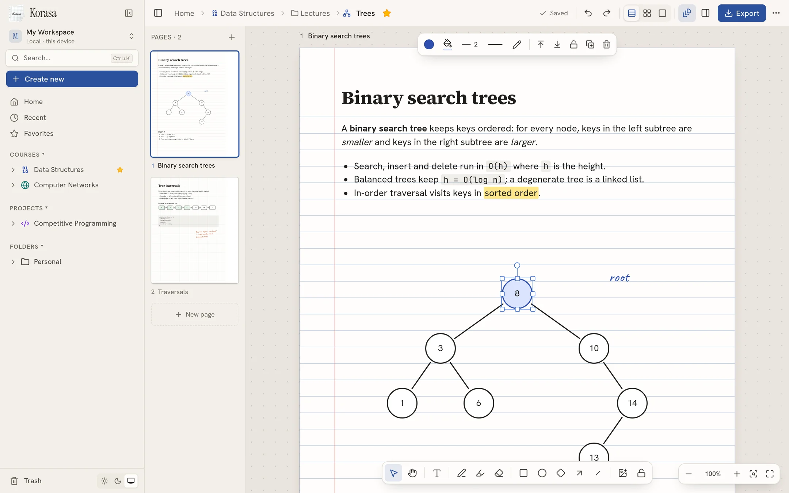
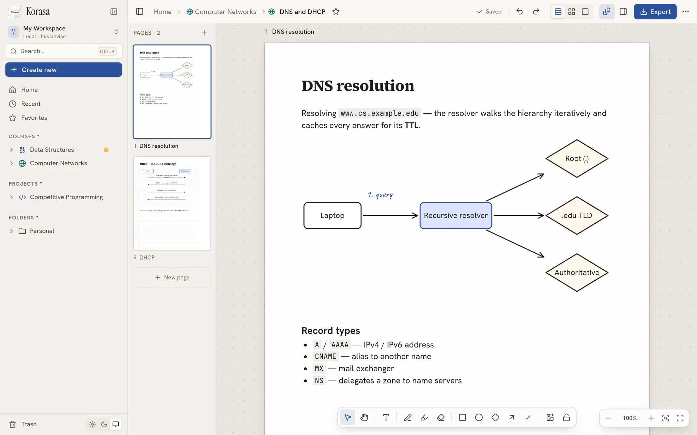
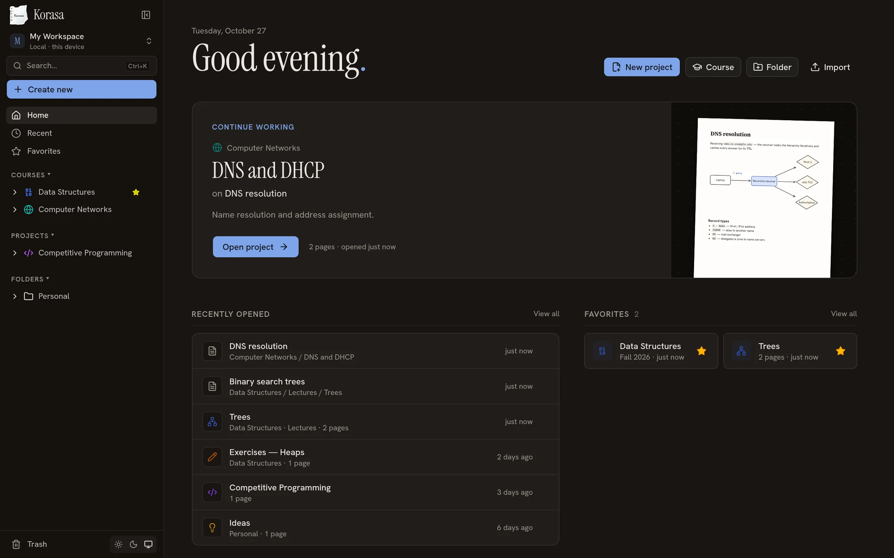
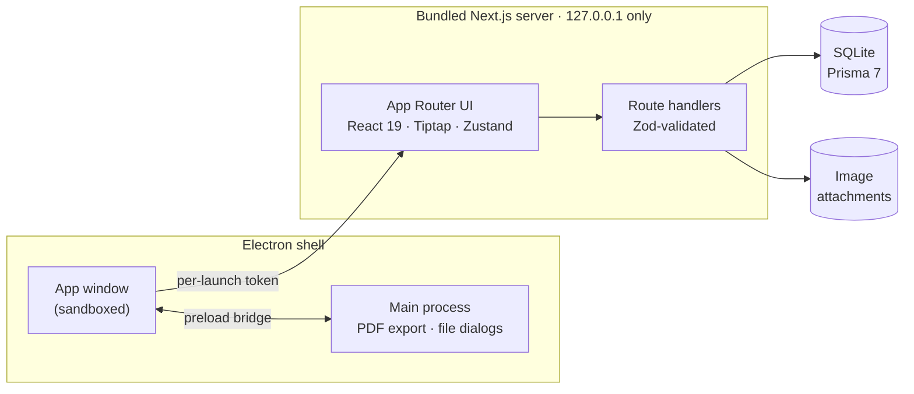

<div align="center">


# Korasa

**Your notebook, on paper that never runs out.**

A local-first workspace for your courses and projects.<br />
Write, sketch, diagram and paste screenshots on real A4 pages — and keep every note on your own computer.

<br />

[](https://korasa.vercel.app)
[](https://korasa.vercel.app/#download)


[**Website**](https://korasa.vercel.app) · [**Download**](https://korasa.vercel.app/#download) · [Features](#-features) · [Development](#-development) · [Architecture](#-architecture)

<br />



</div>

<br />

## ✨ Features

<table>
<tr>
<td width="33%" valign="top">

### 📄 Real A4 pages
Plain, ruled, graph, dotted or bordered paper, portrait or landscape. Stack pages, lay them out freely on the desk, or focus on one sheet.

</td>
<td width="33%" valign="top">

### ✍️ Write anywhere
Click on the paper and type. Headings, lists, code, colours, highlights and sticky notes — real, selectable text edited in place.

</td>
<td width="33%" valign="top">

### 🔗 Diagrams that stay connected
Rectangles, ellipses, diamonds, lines and arrows. Connect two shapes and the arrow follows them. Group, align, rotate, layer.

</td>
</tr>
<tr>
<td valign="top">

### 🖊️ Ink & highlighter
Smooth freehand strokes with stylus pressure, a highlighter, and an eraser that removes whole strokes.

</td>
<td valign="top">

### 🖼️ Paste screenshots
<kbd>Ctrl</kbd>/<kbd>⌘</kbd> + <kbd>V</kbd> a screenshot or drop images onto the page. Resize, rotate and caption them.

</td>
<td valign="top">

### 📤 Crisp exports
A4 PDFs with vector text and shapes (mixed orientations included), PNG pages, and portable project files.

</td>
</tr>
<tr>
<td valign="top">

### 🗂️ Organised like you study
Courses, nested folders and projects, with drag-and-drop, favourites, recents and a trash you can restore from.

</td>
<td valign="top">

### 🔎 Find anything
<kbd>Ctrl</kbd>/<kbd>⌘</kbd> + <kbd>K</kbd> searches names and the text inside every page, and jumps or creates in a keystroke.

</td>
<td valign="top">

### 💾 Never lose work
Autosaves as you type, recovers unsaved edits after a crash, and full undo/redo. Light and dark themes.

</td>
</tr>
</table>

<div align="center">

&nbsp;

</div>

## 🔒 Local-first, for real

Korasa runs entirely on your machine. There's **no account, no server to trust and no telemetry** — it works offline, always.

| | Where your notes live |
| --- | --- |
| 🪟 Windows | `%APPDATA%\Korasa\data` |
| 🍎 macOS | `~/Library/Application Support/Korasa/data` |
| 🐧 Linux | `~/.config/Korasa/data` |

That folder holds a SQLite database and your images — back it up like any other folder. Uninstalling the app leaves it untouched, and any project can be exported as a single `.korasa.json` file to move it elsewhere.

## ⬇️ Download

Get the latest version from **[korasa.vercel.app](https://korasa.vercel.app/#download)** or the [releases page](https://github.com/R4M-0/korasa/releases/latest).

| Platform | File |
| --- | --- |
| Windows 10/11 | `Korasa-windows-x64-setup.exe` |
| macOS (Apple silicon / Intel) | `Korasa-mac-arm64.dmg` / `Korasa-mac-x64.dmg` |
| Linux | `Korasa-linux-x86_64.AppImage` or `Korasa-linux-amd64.deb` |

> [!NOTE]
> The builds aren't code-signed yet. On **Windows**, choose *More info → Run anyway*. On **macOS**, open *System Settings → Privacy & Security* and click *Open Anyway* on first launch. On **Linux**, `chmod +x` the AppImage, or install the `.deb` with `sudo apt install ./Korasa-linux-amd64.deb`.

The first launch opens an empty workspace with a short, skippable tour. Replay it any time from the workspace menu.

## ⌨️ Shortcuts

| Action | Keys | | Action | Keys |
| --- | --- | --- | --- | --- |
| Select / Pan | <kbd>V</kbd> / <kbd>H</kbd> or <kbd>Space</kbd> | | Undo / Redo | <kbd>Ctrl</kbd> <kbd>Z</kbd> / <kbd>Ctrl</kbd> <kbd>Shift</kbd> <kbd>Z</kbd> |
| Text | <kbd>T</kbd> | | Duplicate | <kbd>Ctrl</kbd> <kbd>D</kbd> |
| Pen / Highlighter / Eraser | <kbd>P</kbd> / <kbd>M</kbd> / <kbd>E</kbd> | | Group / Ungroup | <kbd>Ctrl</kbd> <kbd>G</kbd> / <kbd>Ctrl</kbd> <kbd>Shift</kbd> <kbd>G</kbd> |
| Rectangle / Ellipse / Diamond | <kbd>R</kbd> / <kbd>O</kbd> / <kbd>D</kbd> | | Zoom | <kbd>Ctrl</kbd> + scroll |
| Arrow / Line | <kbd>A</kbd> / <kbd>L</kbd> | | Fit all pages / page | <kbd>Shift</kbd> <kbd>1</kbd> / <kbd>Shift</kbd> <kbd>2</kbd> |
| Insert image | <kbd>I</kbd> | | Command menu | <kbd>Ctrl</kbd> <kbd>K</kbd> |

Press <kbd>?</kbd> in the editor for the full list. On macOS, use <kbd>⌘</kbd> instead of <kbd>Ctrl</kbd>.

## 🛠 Development

Requires **Node.js 24+**.

```bash
git clone git@github.com:R4M-0/korasa.git
cd korasa
npm install          # also generates the Prisma client
npm run dev          # applies migrations → http://localhost:3000
```

Want something to play with? `npm run db:seed` fills an empty workspace with sample courses and notes.

| Script | What it does |
| --- | --- |
| `npm run dev` | Migrate the local database and start the dev server |
| `npm run build` / `npm start` | Production build / server |
| `npm run lint` · `npm run typecheck` | ESLint · TypeScript |
| `npm run db:migrate` | Create a migration after editing `prisma/schema.prisma` |
| `npm run db:seed` | Add sample courses and notes to an empty workspace |
| `npm run db:studio` | Browse the database |
| `npm run desktop:dist -- --linux` | Build desktop installers (`--win`, `--mac`; output in `dist-desktop/`) |

During development, data lives in `./data/`. Set `KORASA_DATA_DIR` to put it elsewhere.

### 🚀 Releasing

Push a version tag — GitHub Actions builds every installer on native runners and attaches them to a **draft** release:

```bash
git tag -a v0.2.0 -m "Korasa 0.2.0" && git push origin v0.2.0
```

Try the installers from the draft, then publish it. The website's download buttons always point at the latest published release.

### 🌐 Website

`landing/` is a static site with no build step, deployed to **[korasa.vercel.app](https://korasa.vercel.app)**. Its download buttons detect the visitor's OS and link to the latest GitHub release.

## 🧱 Architecture



<details>
<summary><b>The canvas engine</b></summary>

<br />

Excalidraw, tldraw and Konva were evaluated, but none hosts real rich-text documents inside fixed A4 sheets well (and Konva renders text to a bitmap). Korasa uses a small DOM + SVG engine instead: text is real HTML edited in place with Tiptap, shapes, arrows and ink are SVG, and images are `` elements. Text stays selectable and crisp, and PDF export stays vector. Engine code lives in `src/components/editor/`; the stored format doesn't depend on it.

</details>

<details>
<summary><b>The scene format</b></summary>

<br />

Each page stores a versioned JSON scene (`version: 1`) of z-ordered objects in page units — 1 unit is 1 CSS px of A4 at 96 dpi (794 × 1123). Objects carry an id, type, position, size, rotation, opacity, group and lock state, plus type-specific fields such as rich text, connector bindings or freehand points. Images reference attachment ids; binaries live on disk, never in the JSON. Scenes are validated with Zod on write, and invalid objects are dropped individually on read.

</details>

<details>
<summary><b>Saving and recovery</b></summary>

<br />

Edits mark pages dirty and save after a 700 ms debounce. Each page tracks a local version, so a save that races a newer edit doesn't clear the dirty flag. Failed saves show *Save failed* and retry with backoff. Unsaved scenes are mirrored to local drafts keyed by server revision and flushed with `keepalive` requests on close; the desktop app also flushes before it stops its server. On reopen, a draft is re-applied only if the server hasn't moved on. Undo/redo keeps structurally shared page snapshots, one step per gesture or editing session.

</details>

<details>
<summary><b>The desktop app</b></summary>

<br />

Electron starts the bundled Next.js server (standalone output) in a utility process on `127.0.0.1`, guarded by a secret generated at each launch so other local programs and web pages can't reach it. SQL migrations run at startup against the database in the OS app-data folder. Pages run sandboxed with no Node access; a preload bridge exposes a single action — saving a PDF, which the main process renders with Electron's PDF engine. Build details are in `scripts/build-desktop.mjs` and `desktop/`.

</details>

<details>
<summary><b>Project layout</b></summary>

<br />

```
src/
├─ app/(app)/              dashboard, courses, projects, editor (/p/[id]), trash…
├─ app/print/              A4 print route used for PDF export
├─ app/api/                route handlers
├─ components/editor/      canvas, pages, selection, text editing, toolbars, panels
├─ components/tour/        first-run intro tours
├─ components/layout/      sidebar, command palette, dialogs
├─ lib/editor/             scene format, geometry, objects, clipboard, images
├─ lib/db/                 Prisma client, repository, attachments
├─ lib/export/             PDF, PNG and project-file export
└─ stores/                 Zustand stores: workspace, editor, UI, tours
desktop/                   Electron main process, preload and packaging config
landing/                   website (static, deployed to korasa.vercel.app)
prisma/                    schema and migrations
```

</details>

<br />

<div align="center">
<sub>Made for students and tinkerers. Your notes, your machine.</sub>
</div>
